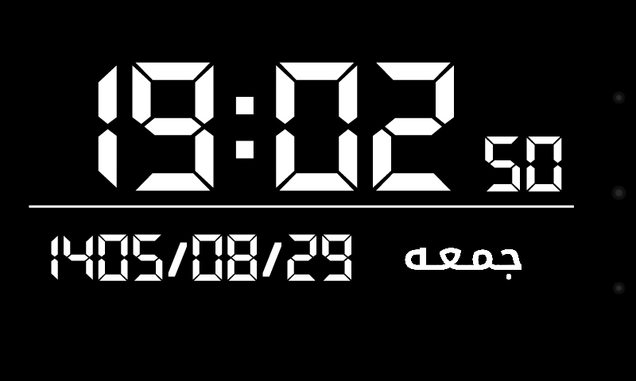
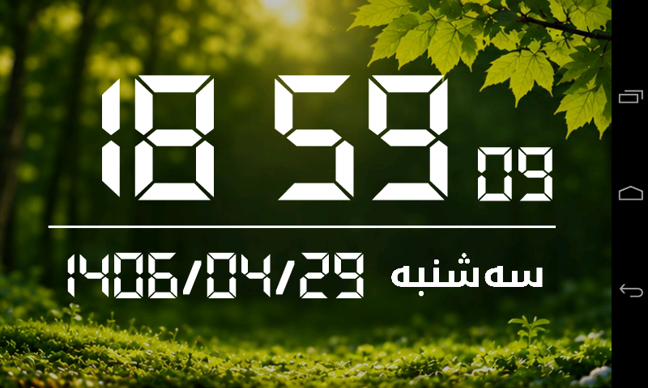
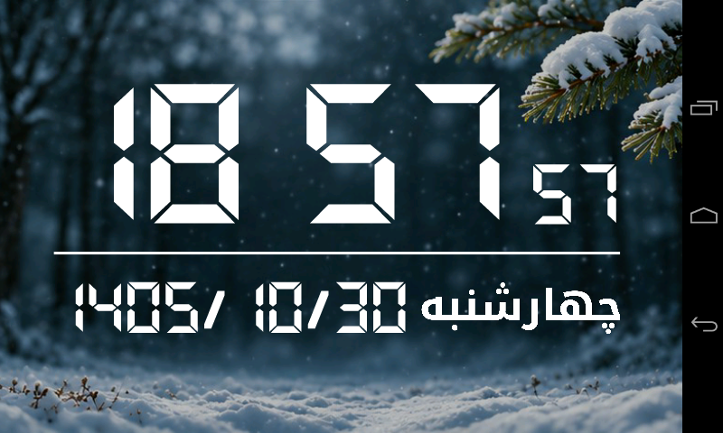
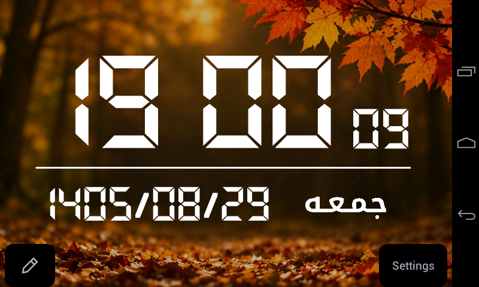
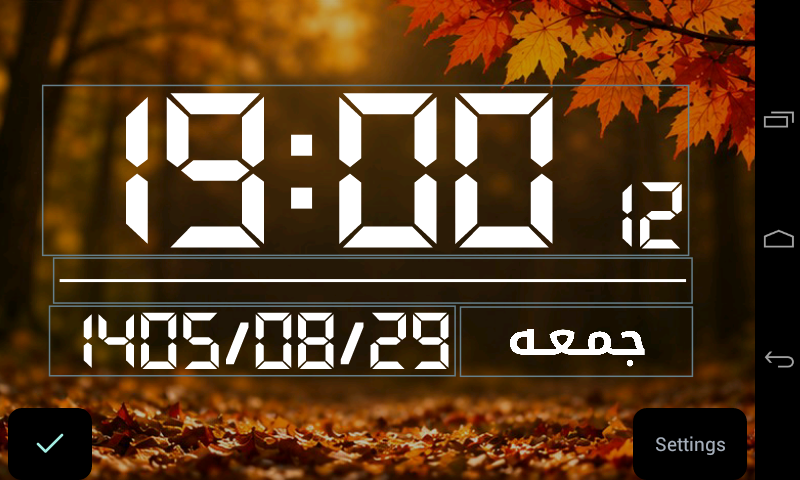
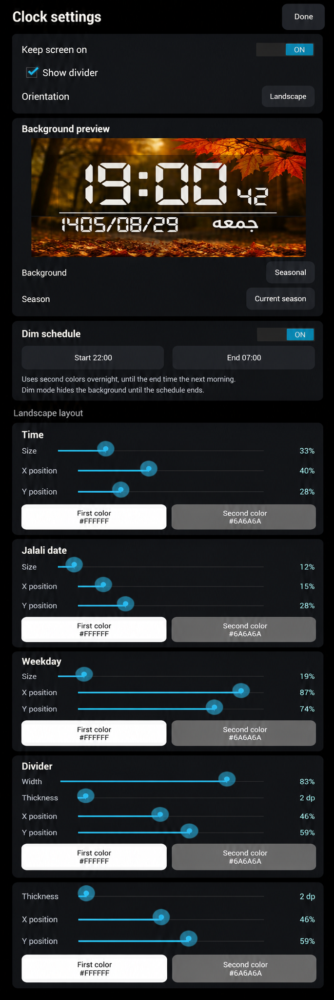

# JClock+

[English](README.md)

JClock+ گوشی یا تبلت اندرویدی شما را به یک ساعت رومیزی آفلاین تبدیل می‌کند. زمان محلی را به‌صورت ۲۴ ساعته با ارقام بزرگ هفت‌قطعه‌ای و ثانیه‌های کوچک‌تر نشان می‌دهد. تاریخ هجری شمسی و نام روز هفته به فارسی هم روی صفحه دیده می‌شوند. برنامه از اندروید ۴٫۱ به بعد پشتیبانی می‌کند.

[](https://github.com/ali79hm/desk-clock/releases/latest) · [همهٔ نسخه‌ها](https://github.com/ali79hm/desk-clock/releases)



## پس‌زمینه‌های فصلی

| بهار | تابستان |
| --- | --- |
|  |  |

| پاییز | زمستان |
| --- | --- |
|  |  |

در بخش **Background**، گزینهٔ **None** پس‌زمینه را مشکی می‌کند، **Seasonal** یکی از چهار تصویر جنگل را نمایش می‌دهد و **Custom** امکان انتخاب عکس از دستگاه را فراهم می‌کند. در حالت فصلی، پس‌زمینه بر اساس فصل تقویم شمسی عوض می‌شود. می‌توانید برای همهٔ فصل‌ها یک عکس یا برای هر فصل عکسی جداگانه انتخاب کنید. برای فصل‌هایی که عکس ندارند، تصویر پیش‌فرض نمایش داده می‌شود. با گزینهٔ **Season** می‌توانید فصل جاری یا یک فصل ثابت را برای ساعت و پیش‌نمایش انتخاب کنید. تصویر پس‌زمینه هر ساعت کمی به چپ یا راست جابه‌جا می‌شود.

## تغییر چیدمان ساعت

| دکمه‌های ساعت | حالت ویرایش |
| --- | --- |
|  |  |

روی صفحهٔ ساعت بزنید تا قلم در سمت چپ و دکمهٔ **Settings** در سمت راست ظاهر شوند. پس از پنج ثانیه بی‌کاری، هر دو دکمه پنهان می‌شوند. روی قلم بزنید تا دور اجزای قابل ویرایش کادر ظاهر شود. هر جزء را با یک انگشت جابه‌جا کنید و با باز یا جمع کردن دو انگشت اندازه‌اش را تغییر دهید. این حرکت برای خط جداکننده، عرض آن را تغییر می‌دهد. برای خروج، روی علامت تأیید بزنید یا دکمهٔ بازگشت را فشار دهید. تغییرات خودکار ذخیره می‌شوند.

## تنظیمات



در **Settings** می‌توانید جهت صفحه را مشخص کنید یا آن را روی **Auto** بگذارید. گزینهٔ **Keep screen on** صفحه را روشن نگه می‌دارد. برای هر جزء، **Size** اندازه و **X position** و **Y position** موقعیت افقی و عمودی را تنظیم می‌کنند. موقعیت از صفر درصد در لبهٔ چپ یا بالا تا صد درصد در لبهٔ راست یا پایین قابل تنظیم است. چیدمان عمودی و افقی جداگانه ذخیره می‌شود. برنامه اندازهٔ اجزا را به فضای موجود محدود می‌کند و برای نام روز هفته به اندازهٔ طولانی‌ترین نام جا در نظر می‌گیرد.

با **Show divider** خط جداکننده را نمایش دهید یا پنهان کنید و نتیجه را در پیش‌نمایش ببینید. بخش **Divider** عرض، ضخامت، موقعیت و رنگ خط را تنظیم می‌کند.

برای هر جزء می‌توانید **First color** و **Second color** را انتخاب کنید. با فعال کردن **Dim schedule**، برنامه در بازهٔ تعیین‌شده از رنگ‌های دوم و پس‌زمینهٔ مشکی استفاده می‌کند. این بازه می‌تواند از نیمه‌شب عبور کند. پس از پایان بازه، رنگ‌های اول و پس‌زمینهٔ انتخابی برمی‌گردند. اگر زمان‌بندی را خاموش کنید، این رنگ‌ها و پس‌زمینه در تمام روز به کار می‌روند.

## ساخت برنامه در Kubuntu یا Ubuntu نسخهٔ x86-64

دستورها را در Bash اجرا کنید. برای ساخت برنامه به Android SDK Platform 16، ابزار Android Build Tools 34.0.0، کامپایلر Eclipse ECJ 3.38.0 و Java 17 یا جدیدتر نیاز دارید.

### ۱. استخراج پروژه و نصب ابزارها

دستورهای زیر را از پوشه‌ای اجرا کنید که فایل ZIP را در آن دریافت کرده‌اید.

```bash
sudo apt update
sudo apt install openjdk-17-jdk curl unzip zip
unzip JClock-Plus-Source.zip
cd jclock-plus
```

نسخه‌های مورد نیاز SDK لینوکس و کامپایلر را در پوشهٔ پروژه دریافت کنید.

```bash
mkdir -p .tooling/android-sdk/platforms/android-16 .tooling/downloads

curl -fL https://dl.google.com/android/repository/android-16_r05.zip \
  -o .tooling/downloads/platform-16.zip
unzip -p .tooling/downloads/platform-16.zip android-4.1.2/android.jar \
  > .tooling/android-sdk/platforms/android-16/android.jar

curl -fL https://dl.google.com/android/repository/build-tools_r34-linux.zip \
  -o .tooling/downloads/build-tools-34.zip
unzip -oq .tooling/downloads/build-tools-34.zip -d .tooling/android-sdk

curl -fL https://repo.maven.apache.org/maven2/org/eclipse/jdt/ecj/3.38.0/ecj-3.38.0.jar \
  -o .tooling/ecj-3.38.0.jar
```

### ۲. ایجاد کلید امضا

دستورهای زیر از شما گذرواژه‌ای با حداقل شش نویسه می‌خواهند. فایل کلید و گذرواژه را محرمانه نگه دارید. برای اینکه نسخه‌های بعدی روی نصب فعلی به‌روزرسانی شوند، از همین کلید استفاده کنید.

```bash
(
  umask 077
  mkdir -p .signing
  if [ ! -f .signing/jclock-plus.p12 ]; then
    read -r -s -p 'Choose a keystore password: ' jclock_password
    printf '\n'
    printf '%s\n' "$jclock_password" > .signing/password.txt
    keytool -genkeypair -storetype PKCS12 -keystore .signing/jclock-plus.p12 \
      -storepass:file .signing/password.txt -alias jclock-plus \
      -keyalg RSA -keysize 2048 -validity 10000 -dname 'CN=JClock Plus'
  fi
)
```

### ۳. ساخت فایل APK

دستورهای زیر را در پوشهٔ `jclock-plus` اجرا کنید.

```bash
export ANDROID_SDK_ROOT="$PWD/.tooling/android-sdk"
export ANDROID_BUILD_TOOLS="$ANDROID_SDK_ROOT/android-14"
export ECJ_JAR="$PWD/.tooling/ecj-3.38.0.jar"
export SIGNING_KEYSTORE="$PWD/.signing/jclock-plus.p12"
export SIGNING_KEY_ALIAS="jclock-plus"
export SIGNING_PASSWORD_FILE="$PWD/.signing/password.txt"
bash build.sh
```

اسکریپت فایل `build/JClock-Plus.apk` را می‌سازد و امضای نسخهٔ ۱ آن را بررسی می‌کند. اگر Android SDK از قبل نصب شده است، مسیرهای فعلی را در متغیرها وارد کنید. اگر `ANDROID_BUILD_TOOLS` تنظیم نشده باشد، اسکریپت از مسیر `$ANDROID_SDK_ROOT/build-tools/34.0.0` استفاده می‌کند.

### ۴. نصب و آزمایش

تبلت را با کابل USB وصل کنید، اشکال‌زدایی USB را فعال کنید و دستور زیر را اجرا کنید.

```bash
adb install -r -f build/JClock-Plus.apk
```

اندروید برای به‌روزرسانی برنامهٔ نصب‌شده به همان کلید امضای نسخهٔ اصلی نیاز دارد. برای آزمایش نسخه‌ای که با کلید خودتان امضا می‌کنید و حفظ برنامه و تنظیمات فعلی، پیش از ساخت این دو تغییر را اعمال کنید.

- در `AndroidManifest.xml`، نام بسته را به `com.jalalidesk.jclockplus.local` و نام اکتیویتی را به `com.jalalidesk.jclockplus.ClockActivity` تغییر دهید.
- در `res/values/styles.xml`، مقدار `app_name` را به `JClock+ Local` تغییر دهید.

اندروید نسخهٔ ساخته‌شده را در کنار نسخهٔ اصلی و با تنظیمات جداگانه نصب می‌کند.

## فایل‌های پروژه

- `src/` حاوی کد جاوا است.
- `assets/seasons/` حاوی چهار تصویر پس‌زمینهٔ پیش‌فرض است.
- `assets/weekdays/` حاوی هفت تصویر نام روزهای هفته است.
- `images/` حاوی تصاویر این راهنما است.
- `res/` حاوی نام برنامه، پوسته و آیکون‌های برنامه است.
- `AndroidManifest.xml` شناسهٔ بسته، نسخهٔ برنامه و تنظیمات سازگاری با اندروید را مشخص می‌کند.
- `build.sh` کد را کامپایل می‌کند و فایل APK را می‌سازد، امضا و بررسی می‌کند.

[نسخه‌های Android SDK](https://developer.android.com/tools/releases/platforms) · [امضای APK](https://developer.android.com/tools/apksigner) · [ADB](https://developer.android.com/tools/adb)
