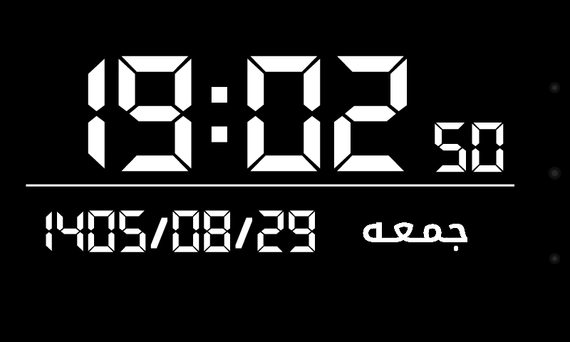
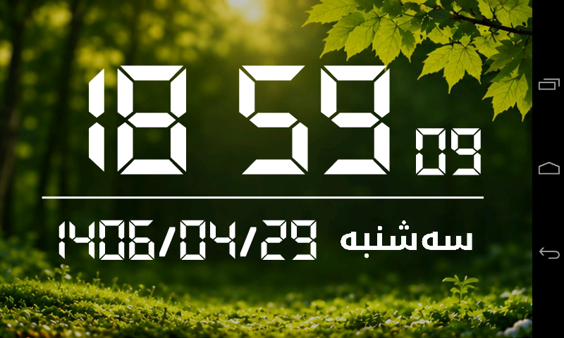
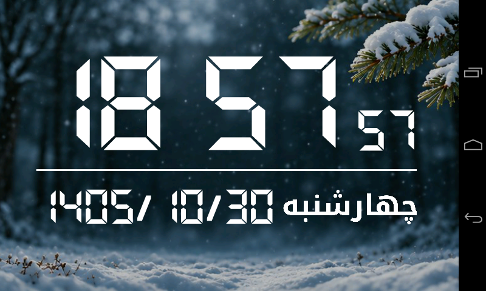
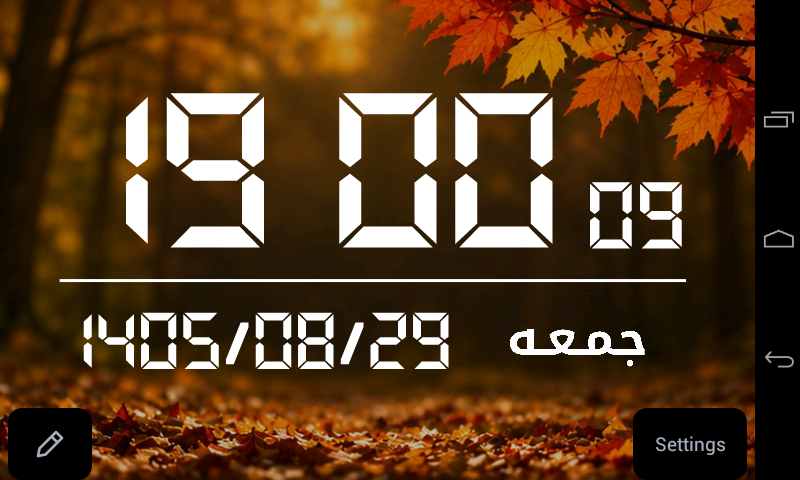
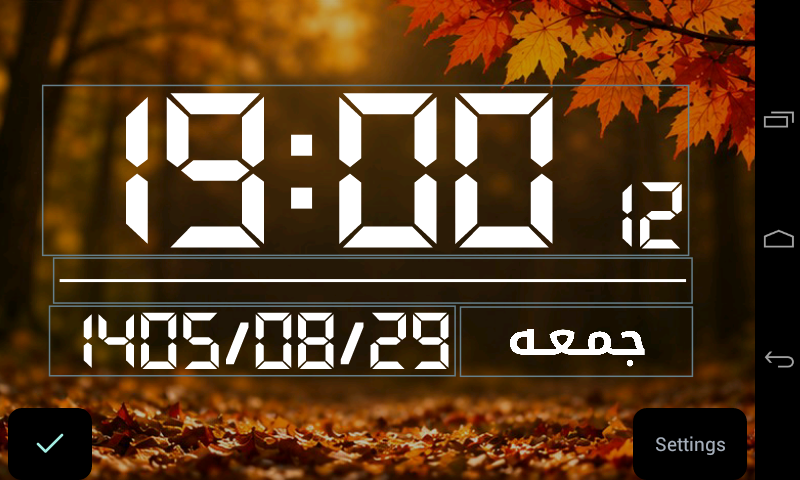
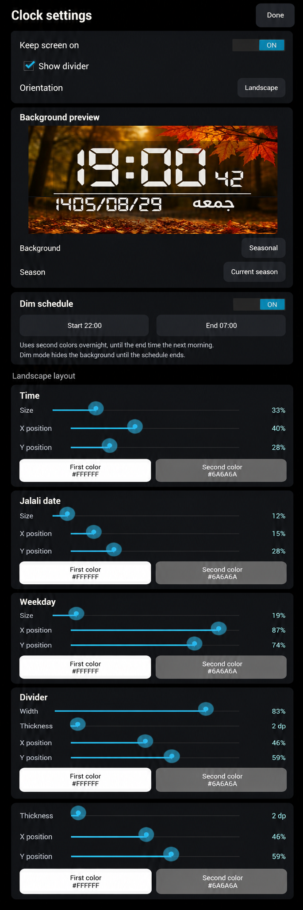

# JClock+

JClock+ turns an Android phone or tablet into an offline desk clock. It shows local time in 24-hour format with large seven-segment digits, smaller seconds, a Jalali (Persian) date, and the weekday in Persian. It supports Android 4.1 and later.

[](https://github.com/ali79hm/desk-clock/releases/latest) · [All releases](https://github.com/ali79hm/desk-clock/releases)



## Seasonal backgrounds

| Spring | Summer |
| --- | --- |
|  |  |

| Autumn | Winter |
| --- | --- |
|  |  |

Under **Background**, choose **None** for pure black, **Seasonal** for the four built-in forest scenes, or **Custom** for photos from the device. Seasonal mode uses months 1–3, 4–6, 7–9, and 10–12 of the Jalali calendar for spring, summer, autumn, and winter. Custom photos can be shared across seasons or assigned individually. Unset slots use the built-in image. Use **Season** to follow the current Jalali season or pin a season for both the clock and the preview. A visible background shifts slightly left or right on alternate hours.

## Customize the clock face

| Clock controls | Editing the layout |
| --- | --- |
|  |  |

Tap the clock to show the pen on the left and **Settings** on the right. Both controls hide after five seconds of inactivity. Tap the pen to outline visible items. Drag an item with one finger or spread or pinch two fingers to resize it. For the divider, pinching adjusts the width. Tap the checkmark or press Back to exit editing. Changes save automatically.

## Settings



In **Settings**, choose an orientation or use **Auto**, and turn **Keep screen on** on or off. Each item has **Size**, **X position**, and **Y position** sliders. Positions run from the left or top edge at 0% to the right or bottom edge at 100%. Portrait and landscape store their layouts separately. The app limits each item to available screen space. The weekday box reserves the width of the longest name in both the clock and Pen mode. The artwork uses a short kashida in یـکشنبه and includes the supplied artwork for جمعه and شنبه.

Turn **Show divider** on or off at the top of Settings and check the live preview. The **Divider** panel has width, thickness, position, and color controls.

Choose a **First color** and **Second color** for each item. Enabling **Dim schedule** uses the second colors and a black background from the start time until the end time, including overnight ranges. The selected background returns when dim mode ends. Disabling the schedule restores the first colors and the selected background throughout the day.

## Build on Kubuntu or Ubuntu x86-64

Use Bash. The build uses Android SDK Platform 16, Android Build Tools 34.0.0, Eclipse ECJ 3.38.0, and Java 17 or newer.

### 1. Extract the project and install the tools

Run this from the folder where you downloaded the ZIP.

```bash
sudo apt update
sudo apt install openjdk-17-jdk curl unzip zip
unzip JClock-Plus-Source.zip
cd jclock-plus
```

Download the exact Linux SDK and compiler used by the build into this project.

```bash
mkdir -p .tooling/android-sdk/platforms/android-16 .tooling/downloads

curl -fL https://dl.google.com/android/repository/android-16_r05.zip \
  -o .tooling/downloads/platform-16.zip
unzip -p .tooling/downloads/platform-16.zip android-4.1.2/android.jar \
  > .tooling/android-sdk/platforms/android-16/android.jar

curl -fL https://dl.google.com/android/repository/build-tools_r34-linux.zip \
  -o .tooling/downloads/build-tools-34.zip
unzip -oq .tooling/downloads/build-tools-34.zip -d .tooling/android-sdk

curl -fL https://repo.maven.apache.org/maven2/org/eclipse/jdt/ecj/3.38.0/ecj-3.38.0.jar \
  -o .tooling/ecj-3.38.0.jar
```

### 2. Create your signing key once

The following block asks you to create a password of at least six characters. Keep the keystore and its password private. Reuse the same key for future builds that should update your own installation.

```bash
(
  umask 077
  mkdir -p .signing
  if [ ! -f .signing/jclock-plus.p12 ]; then
    read -r -s -p 'Choose a keystore password: ' jclock_password
    printf '\n'
    printf '%s\n' "$jclock_password" > .signing/password.txt
    keytool -genkeypair -storetype PKCS12 -keystore .signing/jclock-plus.p12 \
      -storepass:file .signing/password.txt -alias jclock-plus \
      -keyalg RSA -keysize 2048 -validity 10000 -dname 'CN=JClock Plus'
  fi
)
```

### 3. Build the APK

From the `jclock-plus` directory, run:

```bash
export ANDROID_SDK_ROOT="$PWD/.tooling/android-sdk"
export ANDROID_BUILD_TOOLS="$ANDROID_SDK_ROOT/android-14"
export ECJ_JAR="$PWD/.tooling/ecj-3.38.0.jar"
export SIGNING_KEYSTORE="$PWD/.signing/jclock-plus.p12"
export SIGNING_KEY_ALIAS="jclock-plus"
export SIGNING_PASSWORD_FILE="$PWD/.signing/password.txt"
bash build.sh
```

The script writes `build/JClock-Plus.apk` and verifies its v1 signature. If you already have an Android SDK, set these variables to your existing paths. The script defaults to `$ANDROID_SDK_ROOT/build-tools/34.0.0` when `ANDROID_BUILD_TOOLS` is unset.

### 4. Install and test

With the tablet connected over USB and USB debugging enabled, run:

```bash
adb install -r -f build/JClock-Plus.apk
```

The original APK and a build signed with your new key have different signatures. Android requires the original signing key for an in-place update. To keep the original app and its settings while testing your build, make these two edits before building:

- In `AndroidManifest.xml`, change the package from `com.jalalidesk.jclockplus` to `com.jalalidesk.jclockplus.local` and change the activity name from `.ClockActivity` to `com.jalalidesk.jclockplus.ClockActivity`.
- In `res/values/styles.xml`, change the `app_name` string to `JClock+ Local`.

Android then installs your build alongside the original with its own settings.

## Project files

- `src/` contains the Java code.
- `assets/seasons/` contains the four built-in backgrounds.
- `assets/weekdays/` contains the seven weekday label images.
- `images/` contains the screenshots shown in this README.
- `res/` contains the app name, theme, and launcher icons.
- `AndroidManifest.xml` contains the package ID, app version, and Android compatibility settings.
- `build.sh` compiles, packages, signs, and verifies the APK.

[Android SDK versions](https://developer.android.com/tools/releases/platforms) · [APK signing](https://developer.android.com/tools/apksigner) · [ADB](https://developer.android.com/tools/adb)
